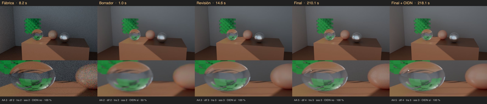

# RenderDesk

Un solo panel para todo el render con Arnold en Autodesk Maya 2026 y 2027 (Mac y Windows): el visor de Arnold, los ajustes de render y unos presets que se combinan, ordenados según el flujo de trabajo (preparar, probar, afinar y renderizar).

> **Estado: fase 1.** Panel acoplado al visor de Arnold con barra de prueba, pestaña Calidad en tres niveles (Sencillo, Detalle, Experto), copia de seguridad con Restaurar y espacio de trabajo «Modo render». Historial y salida llegan en la fase 2. Plan: https://claude.ai/artifact/Grh7sw3cpBeuvqHV2AYbud


## Instalar

Arrastra `instalar.py` desde el explorador de archivos hasta el visor de Maya. Se abre desde el menú **RenderDesk › Abrir RenderDesk**. Para desinstalar, borra `renderdesk.mod` de la carpeta `modules` de tu Maya.

## Presets que se combinan

| Pieza | Opciones |
|---|---|
| Calidad | Borrador · Revisión · Final |
| Tipo de escena | Producto · Interior · Exterior |
| Extras | Vidrio y líquidos · Piel, cera y mármol (SSS) · Hojas y hierba con recorte · Niebla y volúmenes · Desenfoque de movimiento |
| Salida | Imagen fija · Secuencia · Giro 360° |

Los valores viven en `scripts/renderdesk/presets/*.json`. Cada tipo de escena, extra y salida es una lista de reglas (`poner`, `sumar`, `al_menos`, `como_mucho`) que se aplican sobre la calidad, así que ajustar un preset no pide tocar código.

```python
from renderdesk import presets, maya_ajustes
valores = presets.combinar("final", "interior", ["vidrio"])
maya_ajustes.aplicar(valores, etiqueta="Final · Interior")   # guarda copia de lo que había
maya_ajustes.restaurar()                                     # vuelve atrás
```

## Fases

- Fase 1: [docs/fase1_informe.md](docs/fase1_informe.md)
- Fase 0 (medidas): [docs/fase0_informe.md](docs/fase0_informe.md)

## Medidas de la fase 0

Escena de prueba (interior con ventana, vidrio, cera, cromo y hojas recortadas) a 960 × 540 en un MacBook Pro con Maya 2027.2, MtoA 5.6.2 y Arnold 7.5.2. Detalle en [docs/fase0_informe.md](docs/fase0_informe.md).



## Probar

```bash
python3 -m unittest discover tests                                    # sin Maya (el panel necesita PySide6)
maya -command "python(\"exec(open('herramientas/prueba_panel.py').read())\")"  # panel en Maya, con RENDERDESK_RAIZ
mayapy herramientas/medir_presets.py /carpeta/salida 960               # renders con cada preset
mayapy herramientas/componer_lamina.py /carpeta/salida                 # lámina comparativa
maya -command "python(\"exec(open('herramientas/sonda_visor.py').read())\")"   # control del Arnold RenderView
```

## Licencia

MIT. Ver `LICENSE`.

---

**English summary.** RenderDesk is a single dockable panel for rendering with Arnold in Maya: the Arnold RenderView, the render settings and stackable presets (quality + scene type + extras + output). Phase 1 adds the docked panel next to the Arnold RenderView (camera, size, IPR, region, snapshot), the Quality tab in three levels (Simple, Detail, Expert), backup/restore and a «Render mode» workspace. The interface is in Spanish and ready for translation.
