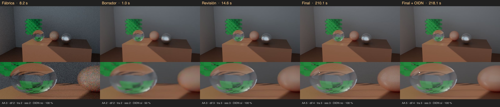

# Fase 0 · Informe

Probado el 24-nov-2026 en el Mac de desarrollo: Maya 2027.2, MtoA 5.6.2, Arnold 7.5.2.0, Qt 6.8.3. No había Maya 2026 instalado; queda pendiente comprobarlo.

## Control del Arnold RenderView desde Python

| Qué | Cómo | Resultado |
|---|---|---|
| Abrir | `cmds.arnoldRenderView(mode="open")` | ✓ crea el workspaceControl `ArnoldRenderView` |
| Render interactivo | `opt=("Run IPR", "1"/"0")`, `get="Run IPR"` | ✓ |
| Región | `opt=("Crop Region", "1")` y el flag `region=(x0, y0, x1, y1)` | ✓ |
| Instantánea | `opt=("Store Snapshot", "1")` | ✓ |
| Guardar imagen (para el historial) | `opt=("Save Image", ruta)` | ✓ escribe el archivo |
| AOV, cámara, resolución de prueba | `get`/`opt` con `AOVs`, `Camera`, `Test Resolution` | ✓ |
| Acoplar un panel propio | `workspaceControl(..., dockToControl=("ArnoldRenderView", "right"))` | ✓ |

Un nombre de opción que no existe («Region», «Snapshot», «Isolate Selected») no lanza error: devuelve `""` y escribe `ARV: Couldn't find option` en el log, así que el panel solo usará nombres comprobados. En MtoA para Maya 2025 no existen `get`, `opt` ni `Camera`.

Leer los píxeles del visor con `QWidget.grab()` da un panel gris: el historial usará «Save Image».

## Ajustes

Todos los atributos del catálogo existen en MtoA 5.6. El limpiador OIDN ya viene en la escena como `defaultArnoldDenoiser`, conectado a `defaultArnoldRenderOptions.imagers[0]`; RenderDesk lo activa y desactiva en lugar de crear otro. El límite de brillo indirecto de fábrica es 10.

Aplicar → leer → restaurar: sin diferencias.

## Tiempos (960 × 540, interior con vidrio, cera, cromo y hojas)

| Preset | Ronda 1 | Ronda 2 |
|---|---|---|
| Fábrica | 8,3 s | 8,2 s |
| Borrador | 1,1 s | 1,0 s |
| Revisión | 40,9 s | 14,6 s |
| Final | 219,8 s | 210,1 s |
| Final + OIDN | 220,3 s | 218,1 s |

Ronda 2: las subidas de muestras de cámara de los extras solo se aplican en Final (antes Revisión llegaba a AA 5).

## Conclusión sobre los valores

Con OIDN, Revisión (15 s) se ve casi igual que Final sin limpiar (210 s). Después de la ronda 2, Final bajó a AA 4 y 2 muestras difusas (las hojas lo suben a AA 5), con un tiempo estimado de unos 120 s. Falta medirlo.

