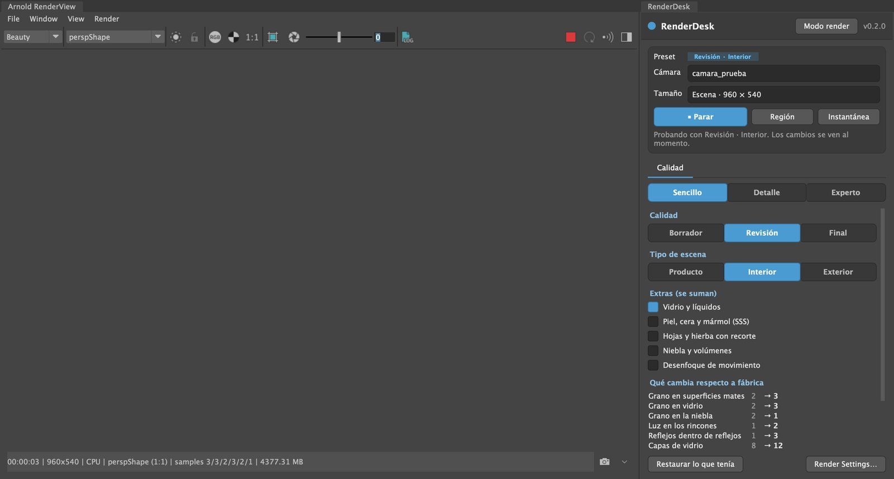
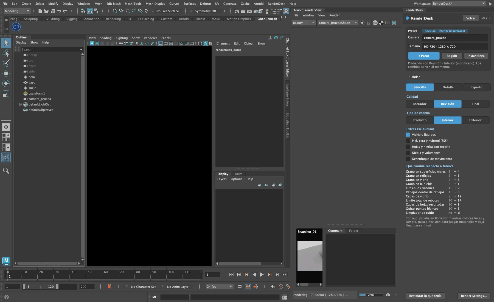

# Fase 1 · Informe

Probado el 24 y 25-nov-2026 en el Mac de desarrollo con Maya 2027.2, MtoA 5.6.2 y Arnold 7.5.2. Para no tocar las preferencias reales se usaron unas aparte. Maya 2026 queda pendiente de probar.

La prueba es `herramientas/prueba_panel.py`. Abre Maya con interfaz, carga el plugin desde el repositorio y recorre la fase entera sola. Los 23 pasos salen bien.

## Qué hay

- **Panel acoplado al visor de Arnold.** «RenderDesk › Abrir RenderDesk» abre el visor y pone el panel a su derecha.
- **Barra superior.**
  - Preset aplicado y cámara. La cámara elegida queda como la única renderizable y es la que usa el visor.
  - Tamaño: HD 1080, HD 720, 4K, cuadrado o vertical, o el que tenga la escena.
  - ▶ Probar / ■ Parar, Región e Instantánea, que manejan el visor de Arnold.
- **Pestaña Calidad, con tres niveles sobre los mismos valores:**
  - Sencillo: calidad, tipo de escena, extras y la lista de lo que cambia respecto a fábrica.
  - Detalle: deslizadores con nombre claro y explicación al pasar el ratón.
  - Experto: atributos reales de Arnold con su valor de fábrica, y un botón a los Render Settings completos.
  - Un punto azul marca lo retocado a mano y el preset pasa a llamarse «(modificado)».
  - El nivel que usaste la última vez se recuerda.
- **Cambios al momento.** Durante el render interactivo, cada cambio se ve enseguida. Solo se escriben los atributos que cambian, con un pequeño retardo para no reiniciar el render a cada movimiento del deslizador.
- **Copia de seguridad y Restaurar.** Antes del primer cambio se guarda en la escena lo que había. «Restaurar lo que tenía» vuelve a ello.
- **Deshacer y cambios desde fuera.**
  - Cada cambio del panel es un solo paso de Ctrl+Z, y el panel se pone al día solo.
  - Lo que se cambie en los Render Settings aparece en el panel como retoque.
- **Modo render.**
  - Un espacio de trabajo propio con el visor de modelado a la izquierda, el visor de Arnold grande en el centro y el panel a la derecha.
  - «Volver» deja el espacio de antes y vuelve a abrir el panel junto al visor.
- **Integración con Maya.** Menú RenderDesk (o submenú dentro de MantiTools), órdenes para el Editor de atajos e `instalar.py` para arrastrar a Maya.

## Hallazgos

- En MtoA 5.6, `arnoldRenderView(get=…)` lanza «Maya command error» mientras el visor no ha renderizado nada. Por eso el panel no lo usa para decidir si el visor se puede manejar.
- El visor nombra las cámaras por su forma (`camara_pruebaShape`), no por el transform.
- Cambiar de espacio de trabajo destruye y rehace los paneles. Por eso el cambio va diferido, y el panel se recupera solo si Maya rehace su ventana.
- Al volver al espacio anterior, Maya lo carga tal como estaba guardado, sin el panel. RenderDesk lo vuelve a abrir.

## Pendiente

- Probar en Maya 2026 y en Windows.
- Volver a medir el tiempo de Final con AA 4 (sigue pendiente desde la fase 0).
