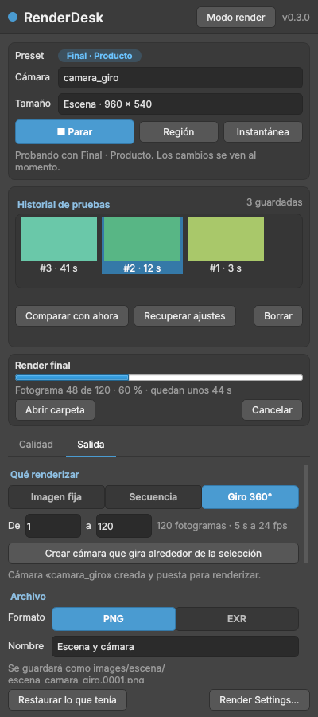
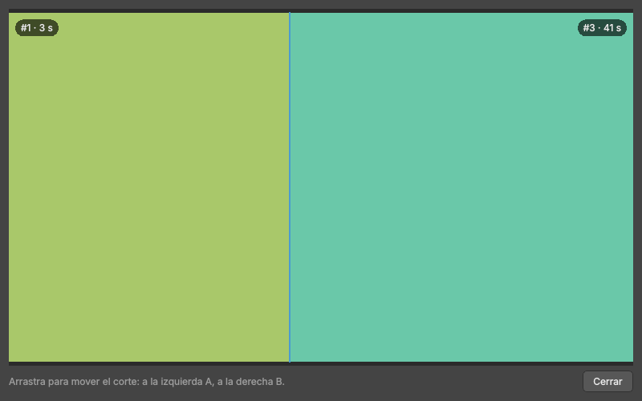

# Fase 2 · Historial y salida

**Estado:** hecha y probada en Maya 2027.2 (MtoA 5.6.2) en un MacBook Pro de 14 núcleos. 69 pruebas sin Maya y 16 de 16 pasos en Maya.

**Entrega:** un giro de 120 fotogramas lanzado en segundo plano mientras se sigue trabajando. En la prueba se renderizaron los 120 fotogramas a 320 × 180 en Borrador en 54 s. Mientras tanto, en la escena abierta se creó y movió una esfera y se cambió dos veces de preset, y Maya respondió igual que sin render (0,17 s para todo eso).



## Historial de pruebas

- **Instantánea** hace lo mismo que antes en el visor de Arnold y además guarda la prueba en `<proyecto>/renderDesk/historial/<escena>/`. Cada prueba son dos archivos: `0001.png` con la imagen del visor y `0001.json` con todos los ajustes, la selección del panel, la cámara, el tamaño, la hora y los segundos que llevaba renderizando desde el último cambio.
- La **tira del historial** va bajo la barra y muestra «#3 · 41 s». Al pasar el ratón sale el preset, la cámara y el tamaño.
- **Comparar:**
  - Con una prueba elegida, se compara con lo que se ve ahora en el visor.
  - Con dos, se comparan entre sí.
  - En los dos casos sale una vista A/B con un corte que se arrastra. El doble clic también compara.
- **Recuperar ajustes** vuelve a poner el preset, los retoques, la cámara y el tamaño de esa prueba.
- **Borrar** quita la prueba.



## Pestaña Salida

| Parte | Qué hace |
|---|---|
| Qué renderizar | Imagen fija, Secuencia o Giro 360°. Secuencia y giro fijan el patrón de ruido (`lock_sampling_noise`) para que no parpadee. Al elegir Giro, el rango pasa a 1–120 (5 s a 24 fps). |
| Crear cámara que gira | Crea el grupo `renderDesk_giro`, que da una vuelta de 360° en el rango, y `camara_giro`, que mira al centro de la selección (o de toda la escena) a la distancia justa para que quepa. La deja como única cámara renderizable. |
| Formato | PNG o EXR (`defaultArnoldDriver.aiTranslator`). |
| Nombre | Escena y cámara, solo escena o solo cámara. Usa las fichas `<Scene>` y `<Camera>`, y cada escena va a su propia carpeta. Muestra un ejemplo de ruta. |
| Pasadas (AOV) | Ninguna, Básicas (difuso, especular, transmisión, SSS, emisión) o Composición (las básicas más albedo, Z, N, P y Cryptomatte). Avisa si hay pasadas en PNG. Solo quita los AOV de los paquetes y no toca los que haya creado la persona. |
| Texturas | Convertir a .tx al renderizar (`autotx`) y usar los .tx que ya existan. |
| Núcleos | Todos menos 2 (por defecto, para seguir trabajando), todos o la mitad. Se recuerda entre sesiones. |
| Final estimado | Se calcula con el tiempo de la última instantánea con tiempo medido. Corrige el cambio de ajustes con `coste.estimar_final`, el tamaño y el número de fotogramas. Avisa si la calidad no es Final. |

## Render final en segundo plano

1. Se exporta una copia de la escena tal como está a `renderDesk/lanzados/<fecha>/<escena>.ma`. La copia lleva los núcleos elegidos y la escena abierta no se toca: en la prueba seguía sin marcar como modificada y con sus hilos como estaban.
2. Se lanza `$MAYA_LOCATION/bin/Render -r arnold -proj … -rd <images> -cam … -s … -e … -ai:lve 2 copia.ma` con QProcess, sin bloquear Maya.
3. La tarjeta de progreso cuenta las imágenes nuevas o reescritas y lee las líneas «NN% done» de Arnold. Con eso muestra «Fotograma 48 de 120 · 60 % · quedan unos 44 s».
4. Al terminar avisa en el visor de Maya y deja **Abrir carpeta**.
5. **Cancelar** para también el Maya en lotes que lanza «Render».
6. El registro completo queda en `render.log` junto a la copia.

## Hallazgos en Maya 2027 / MtoA 5.6.2

- En `defaultArnoldRenderOptions` existen `autotx`, `use_existing_tiled_textures`, `threads_autodetect`, `threads` y `lock_sampling_noise`. En el .ma se guardan como `.thr_auto` y `.thrds`.
- `mtoa.aovs.AOVInterface` crea y quita los AOV de los paquetes sin problemas, Cryptomatte incluido.
- «Save Image» del visor guarda la imagen al tamaño de prueba. Con Borrador al 50 % sale a 480 × 270.
- Una escena nueva de Maya trae el rango 1–10, el formato EXR y el prefijo vacío. Por eso al elegir Giro se pone 1–120.
- `Render -ai:lve 2` escribe tres líneas de progreso por fotograma. Con fotogramas muy rápidos llegan en tandas, así que el porcentaje solo se da por bueno si es del fotograma en curso.
- En la primera vuelta, el primer ▶ Probar tardó unos 200 s en responder. En la segunda tardó 0,06 s. Parece una espera única de Arnold al arrancar por primera vez con unas preferencias nuevas, pero no está confirmado.

## Pruebas

```bash
python3 -m unittest discover tests        # 69 pruebas; el panel y el lanzador necesitan PySide6
maya -command "python(\"exec(open('herramientas/prueba_fase2.py').read())\")"   # con RENDERDESK_RAIZ y RENDERDESK_SALIDA
```

`prueba_fase2.py` hace todo el recorrido:

1. Crea un proyecto y una escena.
2. Prueba en Borrador y guarda una instantánea; pasa a Revisión y guarda otra.
3. Compara las dos y recupera la primera.
4. Prepara un giro con su cámara y prueba formatos, pasadas y texturas.
5. Lanza el giro de 120 fotogramas y sigue trabajando mientras renderiza.
6. Espera a que termine y comprueba las 120 imágenes.

## Pendiente

- Maya 2026 y Windows sin probar. En Windows, Cancelar usa `taskkill /T`.
- Volver a medir Final (AA 4) con un tiempo real.
